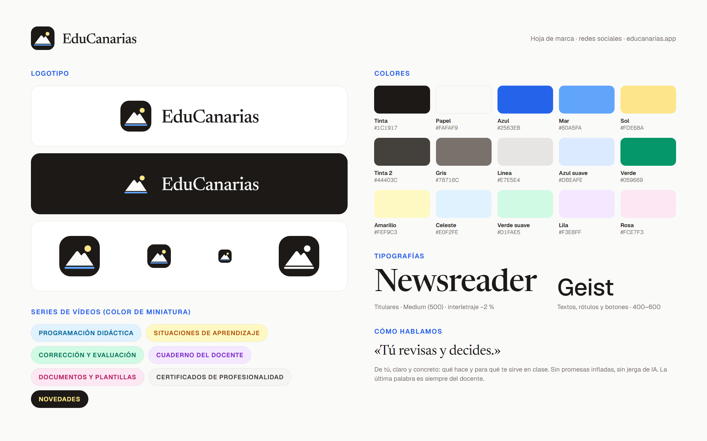

# EduCanarias · materiales para redes

Logos, colores, tipografías, plantillas y textos para montar y llevar las redes de
[EduCanarias](https://educanarias.app), empezando por **YouTube**.



**Para descargarlo todo**: botón verde **Code → Download ZIP**, arriba en esta página.

## Por dónde empezar

1. Leer la **[guía de marca](marca/GUIA_DE_MARCA.md)** (10 minutos): logo, colores, tipografías, tono y lo que no se negocia.
2. Instalar las tipografías de `marca/tipografias/`.
3. Montar el canal con la lista de abajo.
4. Para los próximos vídeos: la **[propuesta de tutoriales](youtube/09-tutoriales/LEEME.md)**, con el calendario, un guion
   por vídeo, cómo grabar y lo que hay que saber del día a día de un docente en Canarias.

## Qué hay en cada carpeta

```text
marca/
  GUIA_DE_MARCA.md        logo, colores (HEX y RGB), tipografías, estilo visual, tono de voz y normas
  hoja-de-marca.png       todo lo anterior en una imagen
  tipografias/            Newsreader (titulares) y Geist (textos), .ttf listos para instalar
logos/
  svg/                    logotipo horizontal y vertical (oscuro y blanco), isotipo, isotipo de una tinta, nombre
  png/                    lo mismo en PNG con fondo transparente, en varios tamaños (el número es el ancho)
youtube/
  01-foto-de-perfil/      800×800
  02-banner/              2560×1440, claro y oscuro, y la guía de zonas visibles
  03-marca-de-agua/       150×150 y 300×300
  04-miniaturas/          ejemplos/ (una por serie) y fondos/ (sin texto, para hacer las tuyas)
  05-pantalla-final/      fondo de los últimos 20 s y guía de dónde van los elementos
  06-cortinilla/          entrada de 3,5 s con el logo animado (MP4, sin sonido)
  07-shorts/              portada vertical 1080×1920, de ejemplo y sin texto
  09-tutoriales/          propuesta de tutoriales: plan y calendario, guiones, cómo grabar, contexto docente y Shorts
  textos/                 descripción del canal, plantilla de descripción de vídeo, listas y hashtags
recursos/
  capturas/               capturas de la app (datos ficticios) con fondo transparente
fuente/                   lo que genera todo lo anterior (no hace falta para usarlo)
```

## Montar el canal de YouTube, paso a paso

| # | Dónde (YouTube Studio) | Qué | Archivo |
|---|---|---|---|
| 1 | Personalización → Información básica | Nombre, identificador, descripción, enlaces y correo | [`youtube/textos/01-canal.md`](youtube/textos/01-canal.md) |
| 2 | Personalización → Imagen de perfil | Foto de perfil (YouTube la recorta en círculo) | `youtube/01-foto-de-perfil/perfil-800x800.png` |
| 3 | Personalización → Imagen del banner | Banner (el texto y el logo están dentro de la zona segura del móvil) | `youtube/02-banner/banner-2560x1440.png` |
| 4 | Personalización → Marca de agua del vídeo | Marca de agua | `youtube/03-marca-de-agua/marca-de-agua-150x150.png` |
| 5 | Configuración → Canal | País, palabras clave, «no es contenido para niños» | [`youtube/textos/01-canal.md`](youtube/textos/01-canal.md) |
| 6 | Contenido → Listas | Crear las listas de las series | [`youtube/textos/03-listas-y-series.md`](youtube/textos/03-listas-y-series.md) |
| 7 | Personalización → Diseño | Tráiler del canal para quien no está suscrito: «Primeros pasos», cuando esté publicado (hasta entonces, ninguno) | [`youtube/09-tutoriales/guiones/01-primeros-pasos.md`](youtube/09-tutoriales/guiones/01-primeros-pasos.md) |

### Medidas de YouTube

| Pieza | Medida | Nota |
|---|---|---|
| Foto de perfil | 800×800 | Se ve en círculo y muy pequeña |
| Banner | 2560×1440 | En el móvil solo se ve el centro: 1546×423. Ver `guia-zonas-del-banner.png` |
| Marca de agua | 150×150 o más | Cuadrada |
| Miniatura | 1280×720 | La esquina inferior derecha la tapa la duración |
| Pantalla final | 1920×1080 | Últimos 5-20 s; los elementos se colocan en Studio sobre la guía |
| Short | 1080×1920 | Arriba (250 px), abajo (430 px) y a la derecha (150 px) los tapa la interfaz |

Todos los archivos de aquí pesan muy por debajo de los límites de YouTube.

### Cada vídeo nuevo

1. **Cortinilla** justo después de los primeros 10-15 s, no antes (opcional, máx. 3-4 s): `youtube/06-cortinilla/cortinilla-1920x1080.mp4`.
   Lo que pasa en los primeros segundos decide si alguien se queda; ver `youtube/09-tutoriales/como-grabar.md`.
2. **Pantalla final** en los últimos 20 s: poner de fondo `pantalla-final-1920x1080.png` y, en Studio → Pantalla final,
   colocar «Vídeo» ×2 y «Suscribirse» encima de los recuadros de `guia-elementos.png`.
3. **Miniatura**: partir del fondo de su serie (`youtube/04-miniaturas/fondos/`), titular en Newsreader, de 3 a 6
   palabras, con 1-3 en *cursiva* del color de la serie. Los ejemplos de `ejemplos/` marcan tamaños y posiciones.
4. **Descripción, etiquetas y hashtags**: [`02-descripcion-de-video.md`](youtube/textos/02-descripcion-de-video.md) y
   [`04-etiquetas-y-hashtags.md`](youtube/textos/04-etiquetas-y-hashtags.md).
5. **Subtítulos** en español, siempre.

## Antes de publicar nada

- ¿Los datos que se ven son **ficticios**?
- ¿Se cuenta solo **lo que la app hace hoy**? (Ante la duda, preguntar a Rayco.)
- ¿Queda claro que **la calificación la pone el docente**?
- ¿Nada que haga pensar que EduCanarias es **de la Consejería**?
- ¿Ninguna **cifra de facturación ni de suscriptores de pago**?

## Licencias

Logotipos, imágenes y textos: © EduCanarias, solo para comunicar EduCanarias. Tipografías Newsreader y Geist: SIL Open
Font License 1.1 (ver `OFL.txt` en cada carpeta).

Dudas o material que falte: a Rayco, `educanariasapp@gmail.com`.
