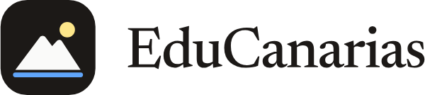
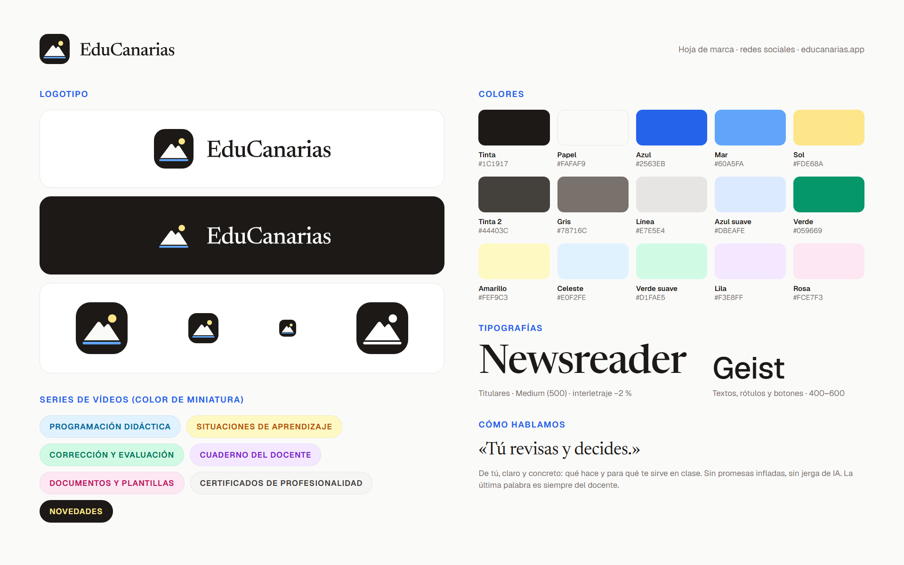

# Guía de marca de EduCanarias

Resumen visual en una imagen: [`hoja-de-marca.png`](hoja-de-marca.png).

## Qué es EduCanarias

Un asistente para docentes de Canarias: programaciones didácticas, situaciones de aprendizaje (SA), pruebas, rúbricas y
corrección con los criterios oficiales del currículo canario (LOMLOE), además de un cuaderno por criterios y plantillas
de documentos. Para Primaria, ESO y Bachillerato, y para formadores de certificados de profesionalidad.
Web: [educanarias.app](https://educanarias.app). Gratis para empezar; Pro desde 9,90 €/mes o 79 € todo el curso.

**A quién le hablamos**: a docentes de centros públicos de Canarias, con poco tiempo y mucha carga burocrática
(programaciones, evaluaciones, informes). No a directores de innovación ni a gente de tecnología.

## Logotipo

El isotipo es **el perfil del Teide sobre el mar, con el sol como punto de luz**. Es también el icono de la app y de la
web, así que es lo que la gente ya reconoce.

| Versión | Archivo | Cuándo |
|---|---|---|
| Logotipo horizontal | `logos/svg/logotipo-horizontal.svg` | La opción por defecto, sobre fondos claros |
| Logotipo horizontal blanco | `logos/svg/logotipo-horizontal-blanco.svg` | Sobre fondos oscuros o fotos oscuras |
| Logotipo vertical | `logos/svg/logotipo-vertical.svg` (y `-blanco`) | Formatos cuadrados o verticales |
| Isotipo | `logos/svg/isotipo.svg` | Foto de perfil, marca de agua, espacios pequeños |
| Isotipo de una tinta | `logos/svg/isotipo-una-tinta-negro.svg` / `-blanco.svg` | Solo cuando no se puede usar color (sellos, grabados, fondos de color) |
| Solo el nombre | `logos/svg/nombre.svg` (y `-blanco`) | Casi nunca: cuando el isotipo ya está al lado en otro sitio |

En `logos/png/` están las mismas versiones en PNG con fondo transparente (el número del nombre es el ancho en píxeles).
Los SVG llevan el nombre en trazos: no hace falta tener la tipografía instalada.

**Área de respeto**: alrededor del logotipo, dejar libre como mínimo **la mitad del lado del isotipo**.
**Tamaño mínimo**: isotipo, 24 px; logotipo horizontal, 120 px de ancho.

**No**:

- Deformarlo, girarlo, ponerle sombra, contorno o degradado.
- Cambiar sus colores o separar el sol, la montaña y el mar.
- Escribir «EduCanarias» con otra tipografía junto al isotipo: usar siempre los archivos.
- Ponerlo sobre fondos con poco contraste (el isotipo ya trae su cuadrado oscuro: funciona sobre casi todo).
- Escribir el nombre de otra forma: **EduCanarias**, junto y con dos mayúsculas. Ni «Edu Canarias» ni «Educanarias».

## Colores

**Principales** (la marca es, sobre todo, papel claro, tinta oscura y un azul para lo importante):

| Nombre | HEX | RGB | Uso |
|---|---|---|---|
| Tinta | `#1C1917` | 28 · 25 · 23 | Texto, fondos oscuros, cuadrado del isotipo |
| Papel | `#FAFAF9` | 250 · 250 · 249 | Fondo principal |
| Azul | `#2563EB` | 37 · 99 · 235 | Acentos, enlaces, botones, la palabra que se quiere resaltar |
| Mar | `#60A5FA` | 96 · 165 · 250 | La línea del mar del isotipo; detalles sobre fondo oscuro |
| Sol | `#FDE68A` | 253 · 230 · 138 | El sol del isotipo; resaltar sobre fondo oscuro |

**Apoyo**:

| Nombre | HEX | RGB | Uso |
|---|---|---|---|
| Tinta 2 | `#44403C` | 68 · 64 · 60 | Texto secundario |
| Gris | `#78716C` | 120 · 113 · 108 | Notas, pies, la URL |
| Línea | `#E7E5E4` | 231 · 229 · 228 | Bordes y separadores |
| Papel 2 | `#F5F5F4` | 245 · 245 · 244 | Fondos de tarjetas |
| Azul suave | `#DBEAFE` | 219 · 234 · 254 | Fondos de etiquetas azules |
| Verde | `#059669` | 5 · 150 · 105 | «Gratis», confirmaciones |
| Verde suave | `#D1FAE5` | 209 · 250 · 229 | Etiqueta «Gratis para empezar» |

**Tarjetas (un color por serie de vídeos**, el mismo que usa la app para cada tipo de material):

| Serie | Fondo | Texto sobre él |
|---|---|---|
| Programación didáctica | Celeste `#E0F2FE` | `#0369A1` |
| Situaciones de aprendizaje | Amarillo `#FEF9C3` | `#B45309` |
| Corrección y evaluación | Verde suave `#D1FAE5` | `#047857` |
| Cuaderno del docente | Lila `#F3E8FF` | `#7E22CE` |
| Documentos y plantillas | Rosa `#FCE7F3` | `#BE185D` |
| Certificados de profesionalidad | Papel 2 `#F5F5F4` | `#44403C` |
| Novedades | Tinta `#1C1917` | Sol `#FDE68A` |

**Guiño volcánico** (solo como luz de fondo en vídeo, nunca para texto): Lava `#EA580C`, Ascua `#F59E0B`, Basalto `#292524`.

## Tipografías

| | Tipografía | Uso | Archivos |
|---|---|---|---|
| **Titulares** | **Newsreader**, Medium (500), interletraje −2 % | Titulares de miniaturas, banners, rótulos grandes. La *cursiva* sirve para resaltar 1-3 palabras (en azul o en el color de la serie) | `marca/tipografias/Newsreader/` |
| **Textos** | **Geist**, Regular a SemiBold (400-600) | Etiquetas, subtítulos, botones, textos largos. Las etiquetas pequeñas, en MAYÚSCULAS con espaciado +8 % | `marca/tipografias/Geist/` |

Las dos son libres (licencia SIL Open Font License, en `OFL.txt` de cada carpeta) y también están en Google Fonts.
Los archivos de esta carpeta son los mismos de la web, con los caracteres del español (y del resto de lenguas de
Europa occidental). Para instalarlas: doble clic en cada `.ttf` → «Instalar».
**En Canva**: buscarlas primero en el catálogo; si alguna no aparece, se sube el `.ttf` desde *Marca → Fuentes* (Canva Pro).

## Estilo visual

- **Fondos**: papel claro con brillos muy suaves (sol arriba a la derecha, azul abajo a la izquierda), o tinta oscura
  para novedades. Se ven en `youtube/04-miniaturas/fondos/`.
- **Lo que se enseña es la app de verdad**: ventanas de la app con sombra suave, hojas de papel con tablas (como un
  documento de Word). Capturas en `recursos/capturas/`.
- **Canarias, con sutileza**: el Teide, el mar, la luz. Sin tópicos de folleto turístico.
- **Nada de**: fotos de stock genéricas, robots, cerebros brillantes, «magia» o destellos de IA, emojis en los titulares
  de las miniaturas.
- **Miniaturas**: 3-6 palabras como mucho, enormes. La esquina inferior derecha queda libre (ahí YouTube pone la duración).

## Cómo hablamos

> «Tú revisas y decides.»

- **De tú**, de docente a docente. Cercano, pero sin chistes forzados.
- **Concreto**: qué hace y para qué te sirve en clase. «Tu programación didáctica, en Word y PDF» mejor que «revoluciona
  tu docencia».
- **El docente decide**: la herramienta propone y el docente revisa. Nunca decir que la app «pone la nota» o «evalúa
  por ti»: *«La calificación la pones tú.»*
- **Sin jerga de IA ni promesas infladas**: nada de «revolucionario», «mágico», «en segundos», «sin esfuerzo».
  «En minutos» sí, porque es verdad.
- **Lemas que ya se usan**: «Prepara tus clases con el currículo canario» · «Tú revisas y decides» · «Gratis para
  empezar · sin tarjeta» · «Clases listas. Domingo libre.» · «El pico más alto de Canarias no es el Teide».

**Palabras y formas que usamos**: situación de aprendizaje (SA, plural «las SA»), programación didáctica (PD),
currículo canario, criterios de evaluación, LOMLOE, Pincel, la Consejería. Cursos como «1.º ESO», «4.º Primaria»;
el curso escolar como «2026-27»; comillas «latinas».

## Lo que no se negocia

1. **Datos ficticios siempre.** En pantalla nunca aparecen nombres, notas, exámenes ni correos reales de alumnado
   o de docentes. Para grabar, usar una cuenta de prueba con datos inventados.
2. **EduCanarias es una herramienta independiente**: no es de la Consejería ni del Gobierno de Canarias. Se puede
   decir que sigue el modelo de programación que publica la Consejería, pero nunca insinuar que es oficial.
3. **Evaluación según la norma**: en ESO se evalúa con niveles de logro (IN, SU, BI, NT, SB) y la calificación la
   decide el docente.
4. **Sin cifras de facturación ni de suscriptores de pago** en ninguna publicación. Sí se puede hablar de lo nuevo
   que llega a la app.
5. **Solo funciones que existen.** Ante la duda, preguntar a Rayco antes de publicar.
